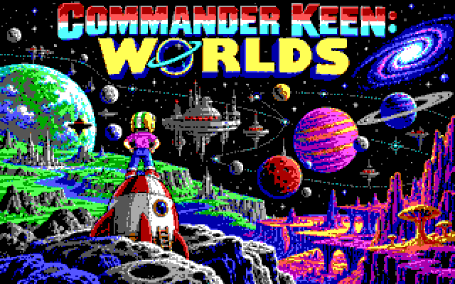
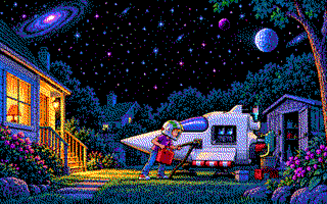
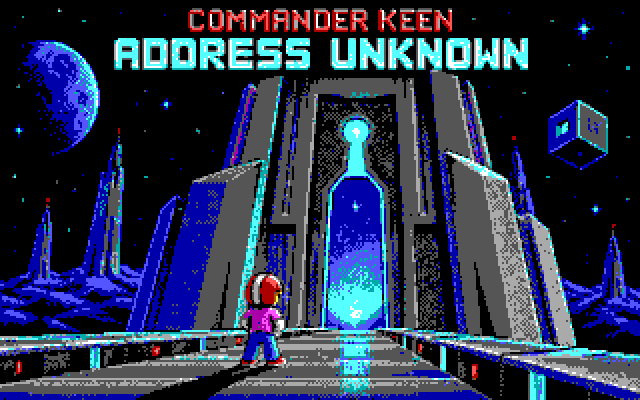
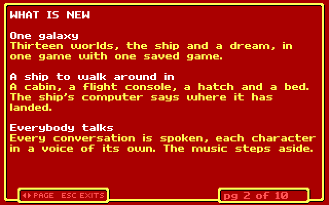
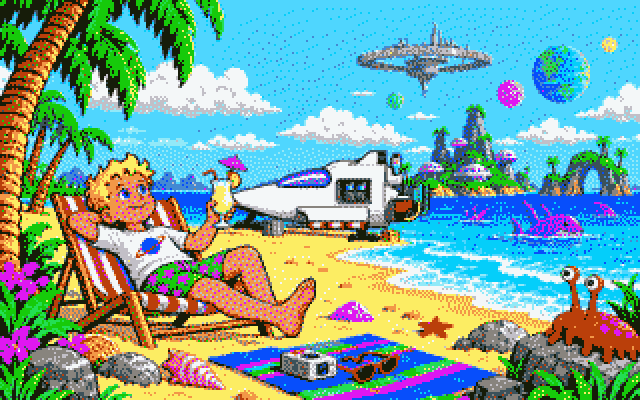

<p align="center"></p>

# Commander Keen: Worlds

**Keen 4, 5 and 6 and the best Commander Keen fan games, joined into one galaxy
that Keen travels in his own ship.**

Keen Worlds is built on [Omnispeak](https://github.com/sulix/omnispeak), the
open-source rebuild of the *Goodbye Galaxy* engine. Instead of starting one
episode, you start inside the Bean-with-Bacon Megarocket, walk to the flight
console and choose where to land: Gnosticus IV, the Shikadi armada, Fribbulus
Xax, or the worlds the Keen community has made since.

> **Beta (0.9.1).** Every world can be played from landing to ending, but few
> people have done it yet. Things will be wrong; finding them is the point.
> See [Reporting a problem](#reporting-a-problem).

**[⬇ Download the latest version](../../releases/latest)** for Windows or
Linux. Keen 4 is included, so it plays straight away.

<table><tr><td>

**📖 The making of Keen Worlds**, on Phosphor Relay

[Phosphor Relay](https://phosphorrelay.grinoir.com) is an experimental
agentic publishing platform, run on its own CMS, Signalweave. Its AI agents
have been documenting how Keen Worlds was made
([what Signalweave Studio and Phosphor Relay are](https://phosphorrelay.grinoir.com/articles/what-is-signalweave-studio-and-what-is-phosphor-relay)):

- [Work in progress 1: The Galaxy After the Credits](https://phosphorrelay.grinoir.com/articles/keen-worlds-the-galaxy-after-the-credits)
- [Work in progress 2: The Megarocket Learns to Remember](https://phosphorrelay.grinoir.com/articles/keen-worlds-2-the-megarocket-learns-to-remember)
- [Work in progress 3: A score built in public](https://phosphorrelay.grinoir.com/articles/milo-hart-joins-keen-worlds-on-music)
- [Work completed: A Galaxy with Memory](https://phosphorrelay.grinoir.com/articles/keen-worlds-a-galaxy-with-memory)

All of them: [phosphorrelay.grinoir.com/tags/keen-worlds](https://phosphorrelay.grinoir.com/tags/keen-worlds)

</td></tr></table>

---

## What Keen Worlds adds

<p align="center">




</p>

- **One galaxy.** Thirteen worlds and a dream in one game, with one saved
  game for all of it.
- **New music.** Original tunes for the AdLib sound card: *The Greatest
  Adventure* plays under the title and the story, the inn in the Border
  Village has a jig of its own, faded in at its door, and the ending has a
  calm tune.
- **Everybody talks.** Every conversation in every world is spoken, each
  character in a voice of their own, Keen too. The music steps aside while
  they speak.
- **Stories read aloud.** A narrator reads each world's story the first time
  Keen flies there.
- **Worlds that remember.** A level Keen has finished can be visited again
  and may have changed. In the Border Village on Gnosticus IV, people have
  moved in, and there is an inn.
- **Two ways to play.** *Free Flight* opens every world at once; *the
  Chronicle* opens them in the order of the story.
- **A dream.** Go to bed in the ship and Keen dreams *Keen Dreams*, the lost
  episode.
- **A beginning and an end of its own.** A new title picture, a story read
  aloud, and an ending for when every world is saved: a last story, Keen on
  the beach, and his boasting at the inn's bar.
- **A guide in the game.** Press F1 to read what is new and how to play.
- **Credit where it is due.** Every world names its makers when Keen first
  lands there.
- **Nothing to convert.** A fan game is unpacked into its folder, and it is
  a world.

## Getting started

1. Download the archive for your system from
   [Releases](../../releases/latest) and unpack it anywhere.
2. Start it:
   - **Windows:** double-click `KeenWorlds.cmd`
   - **Linux:** run `./keenworlds.sh` (needs SDL2: the package is called
     `libsdl2-2.0-0`, `sdl2` or `SDL2`)
3. After the title and the story, choose **New Game**. You start inside the
   Megarocket: walk to the flight console and push **up** to choose a world.

### What is included

The download contains Keen Worlds and **Commander Keen 4: Secret of the
Oracle**, the shareware episode. id Software and Apogee let anyone pass it on
for free. It is in the folder `keen4-shareware`, whole and unchanged, with its
terms in `VENDOR.DOC`.

### Adding Keen 5 and 6

Keen 5 and 6 are still sold (for example on Steam and GOG, both version 1.4,
which is the one needed). If you own them, copy **three files of each** into
the Keen Worlds folder, next to the program:

| Episode | Files to copy |
|---|---|
| Keen 5: The Armageddon Machine | `GAMEMAPS.CK5` `EGAGRAPH.CK5` `AUDIO.CK5` |
| Keen 6: Aliens Ate My Baby Sitter | `GAMEMAPS.CK6` `EGAGRAPH.CK6` `AUDIO.CK6` |

The other `.CK5` and `.CK6` files already in the folder belong to Keen Worlds;
leave them. If your Keen 6 is version 1.5, first copy the files from the
`keen6-v1.5` folder over the ones next to the program.

### Adding the fan games

Each fan game is a world of its own. Download it and **unpack it, as it is,
into its folder under `mods/`**. If the download makes a folder of its own
inside, that's fine. The few files already in those folders belong to Keen
Worlds.

| Folder | World in Keen Worlds | Fan game | Needs |
|---|---|---|---|
| `mods/keen7` | Krodacia | *The Keys of Krodacia*, by Ceilick | Keen 4 |
| `mods/keen95` | Aspermontis | *The Eight Accumulators*, by Bubbatom (2011) | Keen 4 |
| `mods/bounty` | Meurglys III | *Bounty Hunting Brouhaha* v1.0, by Kohntarkosz_ (2019) | Keen 4 |
| `mods/dreams` | Tuberia (the dream) | *Keen Dreams*, shareware v1.13, by id Software | Keen 4 |
| `mods/keen8` | Calidune | *Dead in the Desert*, by Ceilick (2009) | Keen 6 |
| `mods/keen9` | HUB Command Center | *Battle of the Brains*, by Ceilick, Mink and Tulip (2011) | Keen 5 |
| `mods/ck55` | The Omegamatic II | *Keen 5.5*, by The CK Guy | Keen 5 |
| `mods/asylum` | Address Unknown | *Keen Asylum* | Keen 5 |
| `mods/osi` | The Shikadi Station | *Operation Station Infiltration* v1.4, by Ceilick (2022), Omnispeak version | Keen 5 |
| `mods/arealm` | Krisle | *Atroxian Realm* v1.5, by Gridlock (2016) | Keen 5 |
| `mods/fitf` | Gnosticus Pi | *Foray in the Forest* v2.0, by Nisaba and K1n9_Duk3 | Keen 5 |

Where to find them:

- **Krodacia, The Omegamatic II, Address Unknown:** the
  [Omnispeak modding kit](https://github.com/sulix/omnispeak/releases)
  (release "1.2 preview"), folders `data/mod/keen7`, `data/mod/ck55` and
  `data/mod/asylum`.
- **Calidune and HUB Command Center:** [archive.org](https://archive.org),
  search for "Commander Keen 8 - Dead in the Desert" and "Commander Keen 9 -
  Battle of the Brains".
- **Aspermontis, Meurglys III, The Shikadi Station, Gnosticus Pi:** their
  pages on the [Keen Wiki](https://keenwiki.shikadi.net).
- **Krisle:** its thread on [PCKF](https://pckf.com).
- **Keen Dreams:** the shareware version 1.13 is free to pass on, and many
  DOS archives have it.

A world whose game is missing shows as **not installed** in the ship's flight
menu; choose it there to read where it comes from. Start Keen Worlds again
after adding a game.

## Keys

| Key | Action |
|---|---|
| Arrow keys | move, look up and down, enter doors, use the console |
| Ctrl | jump |
| Alt | pogo stick |
| Space | shoot |
| Enter | status |
| Esc | menu: save, load, sound, keys |
| F1 | the guide |
| F11 | full screen |

A voice speaks the conversations. Hold **Esc for one second** to skip a
scene or advance spoken dialogue early; a small bar shows the hold. Once
the voice finishes, a fresh key press advances the text. Release the button
before advancing again.

## Known gaps

- Life in saved levels exists so far only in the Border Village (Keen 4).
- Voices cannot yet be turned off or made quieter on their own.
- Inside the dream there is no menu; save in the ship.
- *The Prisoner's Dilemma* and *Send in the Clorts* are not in yet.
- The Shikadi Station has no ending text, and one of Gnosticus Pi's endings
  is not spoken.
- The Windows version has been tried on few machines.

Meant to be so: Krisle is a one-way trip until that world is saved (the game
warns you), and nothing is carried into or out of the dream.

## Reporting a problem

Please [open an issue](../../issues) and say:

- which world and level you were in, and what you did just before;
- what happened, and what you expected;
- the version, from `VERSION.txt`.

Attach `keenworlds-log.txt` from the game folder (copy it before starting the
game again; each start writes a new one), a saved game from just before the
problem (`KWORLDS?.SAV`), and a screenshot if something looks wrong.

## Building from source

Keen Worlds builds like Omnispeak. On Linux, with SDL2's development files
installed:

```sh
make -C src
```

The program is written to `bin/`. Put the game files and the folders
`megarocket`, `voice` and `mods` from a release (or from `data/`) next to it.
`kwtools/kw_package.sh` makes the release archives for Linux and Windows;
its first lines say which build tools it needs. `doc/keen-worlds.md` describes
how Keen Worlds works inside, and `README-OMNISPEAK` is Omnispeak's own
README, with all its command-line options.

## Credits and license

- **Commander Keen** is by id Software. Keen 4's shareware episode is
  published by Apogee and included under the terms in its `VENDOR.DOC`.
- **Every fan game is its authors' work**, as listed above. Keen Worlds does
  not include them; each world names its makers in the game.
- **Omnispeak** is by David Gow and contributors; see `AUTHORS`.
- **Keen Worlds** was linked together by GriNoir.

The program is free software under the **GNU General Public License,
version 2** (`LICENSE`). The game data of Keen 5 and 6 and of the fan games
is not part of this project and keeps its owners' terms.

If you made one of these worlds and would rather it were not part of Keen
Worlds, please open an issue and it will be taken out.
