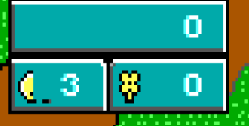

# Next version: player controls, Keen Dreams fixes and new worlds

## Latest review, 2026-10-25

This supersedes the earlier menu and idle Escape-hint notes.
The user chose **Blaze Mk. 8**: a homemade yellow calculator watch with a
purple strap, repair tape, green LCD and a paper mission reminder. Matching
settings, save/load, dialogs and Paddle War preserve familiar controls. The
watch uses one vertical scrolling list. The user then requested two
scrolling columns for the flight chart, keeping its original window size.
It restores meaningful groups: numbered main-story chapters on the left,
independent trips and connected side stories on the right. Each column
scrolls independently, skipping headings, with more arrows and a relationship
line. Four-way navigation, Page Up/Down and Home/End work; full
frame redraws prevent cursor trails. Suburb's destination is named **Earth**. Up opens flight controls at the cabin's blinking sign;
that animated tile had overwritten its own interaction marker.

End Game now returns directly to the title. Its shared score panel replaces
episode high-score demos, which can refer to maps absent from native worlds
(the cabin failed while loading map 19). Keen Dreams retains the compact
Keen 4 watch font instead of treating a bitmap as its missing second font.

A fresh Escape/controller skip hold works immediately, even when Enter
opened the scene and there was no intervening input poll. Progress appears
while held; idle scenes stay free of the hint. The release guard remains.
Alphamatic's crawl now uses a dark left reading area with plain lettering.

Player feedback: Up boards exterior ships, while jump/pogo/fire do not.
Xbox skip defaults to Y and follows remapping. Tests cover button-only
D-pads, analog input and controller-to-joystick hotplug. Gold Edition needs
a separate native port; see `../../research/keen-dreams-gold.md`.

Tests: all 18 native worlds, all 15 boarding destinations, 18 scrolling watch-menu
renders, 11 submenus, the final Options entry, a save dialog, Paddle War,
every flight-list selection, first-press skip, the workshop opening,
Suburb and Alphamatic. Normal and sanitizer checks pass. Local install only;
user testing and commit review are still pending. Native watch captures:
`../../art/blaze-mk8/`. Original sketches: `../../art/watch-concepts.html`.

Current release: **0.9.2 beta**.
Expanded world research: 2026-10-25.
Story placement and arcade decision: [Chronicle timeline](chronicle-timeline.md).

The first two priorities come from player feedback. The user has also
accepted voice volume, controller skipping and story replay as important.
This document records the plan, implementation and remaining human-testing
notes. The 0.9.2 beta is built for Linux and Windows. New-world candidates
still need assessment.

## Current working mode — user direction, 2026-10-25

The user requested a normal **0.9.2 beta** release with Linux and Windows
packages for both the public and private repositories. Human campaign and
real-PC testing remain open for follow-up. `play/test-here.sh` runs the current local
executables through the normal title and narrated opening, with no compilation
or packaging. The old forced cabin start (`/TEDLEVEL`, `KW_AUTOLEVEL`) was
removed after hands-on testing reported the missing opening.

Original Keen 1, 2 and 3 v1.31 are installed in `play/arcade/keen1`,
`play/arcade/keen2` and `play/arcade/keen3`. The user's Keen 3 v1.0 files
were upgraded with their downloaded `3keen131.exe`: the executable,
EGALATCH, LEVEL10 and LEVEL13 changed; all other files, including saves,
were preserved. The upgraded executable matches the canonical v1.31 MD5
`441f21f7b045a8446f8067bb84afb75d` and reaches the native engine's intro.
All three originals have the required files for local arcade testing.
The cabinet's data check requires external SOUNDS only for Keen 1; Keen 2
and 3 embed sounds in their executables. The local test executable includes
this correction.
All three installed originals passed native launch/return checks through
the actual process bridge with isolated temporary saves. Hands-on gameplay
testing in the cabin remains next.
Arcade launches follow the actual window's display coverage, with SDL flags
and the saved setting as fallbacks. This covers the user's Super+F desktop
shortcut, which can disagree with the game's saved fullscreen option, in
both directions. Return restores fullscreen if the parent had it. Regression
checks cover both launchers and desktop/saved-state disagreement. A rendered
desktop test verified original Keen 1 and the remake at 1920×1080, returning
to a fullscreen parent after both.

Hold-to-skip and the corner hint apply to story scenes/pages. Popup dialogue
uses a separate wait: any fresh key/controller tap (including Escape)
advances immediately and stops a spoken line if necessary, with no skip hint
or hold gesture. Held entry keys and auto-repeat cannot dismiss the popup.
Marooned on Mars - Galaxy is now converted from the user's September 2020
fixed ZIP and installed in `play/arcade/mars`. Keen 1 → Galaxy remake launches
it in a separate native Galaxy process, starting on Mars with zero shots.
Escape → Return to cabin closes it; saves, scores and settings stay in its
own directory. It is excluded from destinations and Chronicle completion.
The converter pins the patch revision and checks all 313 actions against
the patched Keen 5 v1.4 data. Native rules cover enemies, ship parts, pogo
ownership, ice, statue hints, preserved teleporter coordinates and the ending.
All 18 maps loaded and ran for 90 real play-loop frames. Focused gameplay,
save/load, all four statue dialogues and the ending passed ASan/UBSan with
the Nuked OPL backend. The complete 16-world regression passes normally;
the full UBSan run still stops on an older negative shift in Atroxian Realm
(`kw_ar_act2.c:457`), outside this port. DBOPL has existing signed-overflow
arithmetic during setup; both audio backends pass the audio output tests.
Native process/argument/save separation and both screen modes pass for the
remake, including actual child-process startup and return. A human full
playthrough remains part of local testing.
The prior executable and replaced support files are backed up under
`play/.local-test-backup/`; existing save slots were retained.

## 1. Let players turn voices off

**Request:** Some players do not want voices. Give them a setting in the
options menu.

### Proposed behavior

- Add **VOICES (ON/OFF)** under the existing Options menu, available from
  the title menu and during play.
- One switch covers character dialogue, the narrator, ship announcements
  and spoken endings. Default to On, preserving the current experience.
- Remember the preference across restarts, new games, loaded games and
  travel between worlds. It is a player preference, separate from a save.
- Keep music and sound effects independently selectable. Players can mute
  voices while keeping both, or keep voices while turning sound effects off.
- Turning voices off stops any current speech and lets the appropriate
  music resume. Disabled speech must not trigger music fades or leave the
  game waiting for the duration of a silent clip.
- Keep all written dialogue and story text. With voices off, dialogue
  advances on a fresh key/button press; story scenes keep their normal
  pacing and the one-second Escape hold for skipping.
- Turning voices back on enables subsequent lines; it does not restart a
  scene or replay a line already dismissed.

**Decision to discuss:** One switch for all voices, or separate switches
for dialogue and narration? Start with one switch unless players need the
extra distinction. Voice volume is proposed below as an addition to 0.9.2.

## 2. Make the skip hint less dominant

**Request:** The new Escape sign draws too much attention. Make it quieter,
possibly in the upper-right corner.

### Proposed appearance

- Move the hint to the **upper-right corner**, with a small inset from
  the edges of the 320×200 picture.
- Use a compact label such as **Hold Esc to skip**, with restrained,
  readable colours that work with each world's palette.
- Remove the wide, filled footer and the permanent empty progress bar.
- Show a short underline or small progress indicator only while Escape
  is being held. Keep it beside the hint.
- Give the scene's artwork and words priority. Check placement against
  title lettering, story text and dialogue illustrations before fixing
  the final size and inset.
- Show this hint during story scenes and story pages, outside normal
  gameplay. Apply the same treatment to “Press a key to continue” and
  “Release to continue,” so another large prompt does not replace it.

**Recommended visibility:** Briefly show the hint when a scene starts
(roughly two seconds), then hide it. Bring it back when **any key or
controller button** is pressed, so players discover the controls even if
they try moving, jumping or firing first. Show progress only while Escape
is held. Update the hint when a story page becomes ready to advance,
so players can discover that a normal press now works.

**Agreed direction:** A small upper-right hint, briefly shown at scene
start and revealed again by any key or controller button. Holding Escape
still performs the skip.

- Reveal the hint on a fresh press, with the same brief display period.
  Holding a gameplay button or receiving auto-repeat does not keep it visible.
- A press that already advances a finished story page should still do
  so immediately; revealing the hint must not consume a valid action.
- Keep this behavior within story scenes/pages. Popup dialogue uses fresh
  taps without a skip hint. Ordinary gameplay and menu
  controls continue to act normally.

### Keep the current skip safeguards

- A full one-second Escape hold skips a story scene or advances a narrated
  story page early. A quick tap leaves the story playing.
- Moving, jumping and shooting leave story scenes and narration playing.
- Popup dialogue advances on a fresh tap, even during speech, with no hint.
- Require a release between scenes/pages. Held keys and auto-repeat must
  not skip several in succession.

## Suggested scope for 0.9.2

Finish these two changes together, then test the interaction between them:
voices off should feel responsive, and voices on should remain easy to
listen to without a dominant prompt.

## Accepted additions

The user accepted items 3–5 as good and important. The recommendations below
describe delivery order; they are no longer awaiting feature approval.

### 3. Voice volume

Some players want quieter voices rather than switching them off completely.
Add a separate voice-volume control beside the voice preference and remember
its level between sessions. Switching voices off and back on should retain
the chosen level. Keep music and effects independent.

**Delivery recommendation:** Include this with the voice-options work.

### 4. Controller-friendly skipping

Let controller players hold their mapped menu/back button for one second
to skip. Show that button in the small hint when a controller is being used,
and Escape when the keyboard is being used. Other buttons reveal the hint.
Keep the same release and accidental-skip protections for both devices.

**Delivery recommendation:** Implement alongside the hint redesign.
Revealing a keyboard-only instruction from a controller button would
otherwise leave those players reaching for a keyboard.

### 5. Replay a world's story

Offer a way to read or hear an already discovered world's story again,
using its existing text, narration and artwork. A possible location is a
“Replay this world's story” menu entry; a ship archive could come later.

Respect the current voice preference and volume. Replaying a story should
preserve the current level, world progress and saved-game state.

**Delivery recommendation:** Implement after the shared voice/hint work.
It gives players a way to revisit something they skipped without starting
a new game. Verify menu placement and restoring the current game before
including it in a release.

## 6. Fix the Keen Dreams stats display

**Player report:** The score/lives/flower-power box looks wrong.

**Investigation:** Reproduced locally in Dreams level 1. The lives icon is
partly erased. The shared scorebox updater writes two life digits, including
a leading blank, but the Dreams layout reserves one digit beside the icon.
That blank overwrites part of Keen's portrait, leaving the crescent-like
shape in the screenshot.

The current Dreams settings also request seven score digits. The original
Dreams code uses six digits with a different starting position, so check
the entire layout rather than repairing only the visible icon.

### Required fix and checks

- Restore a Dreams-specific layout for score, lives and flower power.
- Preserve the complete lives icon, number spacing and box borders.
- Retain the flower/bomb icon change in Boobus Tuber's chamber.
- Check zero, one/two-digit ammo, changing score, losing/gaining lives,
  scrolling and loading a save. Define how lives above nine are displayed
  without overwriting the icon; the original display caps that digit at nine.
- Compare displayed counts with the underlying game state. The screenshot
  establishes a drawing defect; it does not establish incorrect inventory.
- Correct the generator and packaged Dreams metadata as needed, so conversion
  or regeneration cannot restore the bad layout.

**Priority:** Fix before expanding the world roster. This is an existing
player-visible defect in the released game.

Technical references: [ck_map.c](../src/ck_map.c),
[Dreams metadata](../data/mods/dreams/DREAMS.KDR),
[kw_dreams_port.py](../kwtools/kw_dreams_port.py), and the original
[Dreams scorebox implementation](https://github.com/keendreams/keen/blob/master/kd_keen.c).

## 7. New worlds

See [More games for Keen Worlds](world-candidates.md) for the expanded
shortlist: Marooned on Mars — Galaxy, Operation Ocflore, Suburb Shenanigans,
Aurora Bliss, Canmore's Redemption and Return to the Shadowlands, plus the
longer-term possibility of original Keen 1–3 support.

Adding destinations is a development track alongside the usability work.
Assess one candidate first and finish it through its ending before committing
to a batch of worlds.

| Candidate | Why it fits | Work to assess |
| --- | --- | --- |
| **The Alphamatic — first choice** | A Keen 5 adventure continuing Atroxian Realm, already part of Keen Worlds. The author's release thread lists version 3.0. | Native v3.0 port implemented locally, including transport/progression and the custom 24-hit machine. See the [implementation audit](../../research/the-alphamatic.md); human campaign testing remains. |
| **The Prisoner's Dilemma — second track** | Continues Bounty Hunting Brouhaha, which is already installed as Meurglys III. | Local download exists. Previous investigation was blocked by the exact Keen 6 v1.4 executable needed to interpret the patches. Review the Keen/Rick routes and current bug-fix baseline. |
| **Send in the Clorts — after Prisoner** | Concludes that trilogy; its author released it as a beta. | Local download exists. Audit its Keen 5 patches and available fixes, and test its changed mechanics and ending. |

These are candidates, not claims of working Keen Worlds support. A completed
DOS mod can still require substantial changes to this engine.

### Recommendation

Start with **The Alphamatic** as the next new destination. In parallel with
planning, clarify the Prisoner compatibility blocker and the correct release/
fix versions for both trilogy sequels. Preserve their story order.

A new world is ready when installation from the player's own download,
arrival and return travel, special gameplay, save/load, story presentation
and the ending all work. Extend regression coverage and human play-throughs.

**Version-selection update, 2026-10-25:** The community
[bug-fix project](https://pckf.com/viewtopic.php?p=95396) lists a corrected
Kohntarkosz trilogy package, updated 2024-12-24. Inspect it before using the
older local Prisoner/Clorts downloads; check whether its fixes change our
porting requirements. The previous executable-version blocker still needs
to be verified.

### Sources checked for this plan

- [The Alphamatic: author's release thread](https://pckf.com/viewtopic.php?t=4086).
- [The Prisoner's Dilemma: author's version 1.0 announcement](https://pckf.com/viewtopic.php?t=11632).
- [Send in the Clorts: author's beta announcement](https://pckf.com/viewtopic.php?t=11633).
- Local research: `../../research/bounty-hunting-brouhaha.md` and
  `../../future.md`; the downloaded Prisoner README recommends Keen 6 v1.4.

### Release focus

Prioritize the Dreams HUD repair and the accepted player-control changes.
Story replay is also accepted; verify its effect on the current game before
shipping. Assess The Alphamatic separately so an unfinished world port does
not delay fixes for current players. Set the new-world release boundary after
the compatibility assessment, while allowing room for further 0.9.1 reports.

## 8. Original Keen 1–3 on a shipboard arcade cabinet

**User decision:** If the original trilogy is integrated, make it playable
on an arcade machine in a corner of the spaceship. This is its agreed
access point; it does not commit the original-engine port to 0.9.2.

Keep arcade progress separate, return the player to the cabin on exit,
and exclude these games from the required Chronicle/world-completion count.
The cabinet should not obstruct the bed, hatch or flight console.

**Further user decision, 2026-10-25:** Selecting Keen 1 offers **Original
Keen 1** or **Marooned on Mars — Galaxy (enhanced graphics)**. Keen introduces
the updated version before the choice. Keep saves/progress separate for
each version and show which supported games are installed. The remake is
accessed through this cabinet, outside the main Chronicle.

Include the requested Duke Nukem arcade reference: **“Hmm, don't have time
to play with myself.”** Suggested follow-up: **“Well… maybe one game!”**
Use it occasionally when interacting with the cabinet, with text and speech
respecting the voice preferences. Attribution, proposed dialogue and the
menu flow are recorded in the timeline below.

The [timeline](chronicle-timeline.md) records the original trilogy's
historical order and a proposed placement for every new candidate.

## Ready-to-release checks

- [ ] Voice preference is easy to find and survives quitting/restarting.
- [ ] All speech types respect it, with text, music and effects working.
- [ ] Disabled voices cause no silent waits or unnecessary music fades.
- [ ] Screenshots show the smaller hint on light/dark scenes and custom palettes.
- [ ] Hiding, moving and restoring the hint leaves no marks on the artwork.
- [ ] Skip timing, fresh presses and release guards still work with voices on/off.
- [ ] Controller skipping shows the mapped button and keeps the release guard.
- [ ] Story replay restores the current game without changing world progress.
- [ ] Dreams HUD icons and counters render correctly and match the game state.
- [ ] Existing saves still load; opening, landing, dialogue and ending flows work.
- [ ] Test on Linux and a real Windows PC, including a player's normal audio setup.
- [ ] Update the guide/README and regression checks before building release files.

## Implementation references

- Menus: [ck_us_2.c](../src/ck_us_2.c).
- Saved preferences: [id_cfg.c](../src/id_cfg.c).
- Voice loading, timing and music: [kw_music.c](../src/kw_music.c).
  Currently speech also checks whether sound effects are enabled; independent
  voice controls need to account for both single and combined clips.
- Hint drawing, placement and saved background: [kw_skip.c](../src/kw_skip.c).
  Move the background preservation area along with the hint.
- In-game instructions: [ck_text.c](../src/ck_text.c).

## Further discussion

Add the next player reports and decisions here before implementation.

## Implementation update, 2026-10-25

Implemented locally (not published):

- Configure → Options → Voices: independent on/off and 0–100% volume in
  10% steps, retained in OMNISPK.CFG. Zero volume is silent without waiting
  for clips. The off switch retains the chosen level. All single and combined
  speech paths respect these settings, independently of music/effects.
- The skip overlay is a restrained upper-right hint. It hides after two
  seconds, reappears on a fresh key/controller press and when a story page becomes
  ready to advance, and draws progress only during a hold. Original pixels
  are restored before animated frames and on exit. Mapped controller menu
  buttons use the same one-second hold and release guards as Escape.
  Popup dialogue has no hint and uses an ordinary fresh press to advance.
- Replay World Story is available in the pause menu while visiting a
  discovered planet. Replay runs after the menu closes, keeps the loaded
  level, restores its colours/music and invalidates the scorebox cache.
  It does not switch worlds, reload a level, or alter the save format.
- Dreams uses the original six-digit score position, one-digit lives field
  capped at nine, and its flower/bomb layout. Its shipped metadata and Python
  generator agree. Underlying score/lives are not capped by this display.
- The aft cabin has a cabinet beside the bunk. Original Keen 1, 2 and 3 run
  in a native Chocolate Keen companion with independent per-episode saves,
  scores and settings. Game data is player supplied (original v1.31).
  Closing the game returns to the still-loaded cabin. The cabinet and its
  games are outside the destination list and Chronicle completion count.
- Keen 1's version choice and arcade joke now include Keen's established
  voice (bm_fable, speed 1.2), respecting voice on/off and volume. The joke
  plays once again after upgrading from the text-only introduction. Ordinary
  fresh presses advance these popups, including while speech is playing.
  The Galaxy remake is playable natively, with separate saves in arcade/mars.
- The Alphamatic 3.0 compatibility audit is recorded in
  [research/the-alphamatic.md](../../research/the-alphamatic.md). It is now installed as a native world, including the custom machine,
  transports, original illustrated opening, both endings and dedicated speech.
- Make, CMake, the local run script and release packager include the native
  companion. Its pinned GPL source and license are under
  third_party/chocolate-keen; no Vorticons game data was vendored.
- Full sanitizer testing also exposed old graphics-loader boundary reads:
  fixed the fixed-width map-name log and Huffman read at the end of a chunk.
  Guarded the original uninitialized animation-timer index in Keen 6.

Validation covers the actual audio output at five volume levels, independent
speech and mute behavior, controller/input timing, the real Dreams updater
with artwork canaries, native process/argument/save separation for all three
originals, and guarded compressed-data boundaries. The Windows native-process regression
also passes under Wine. Scripted SDL input checks
story replay against the entire game/world state. Make/CMake and Windows
cross-builds were exercised. The full 15-world self-test passes with ASan and
UBSan configured to stop on the first error. Original Keen 1 reaches its own intro natively.

Human testing remains open after this beta: real Windows play (including
audio/controller use), complete original Keen 2/3 play checks with
player-supplied data, a human cabinet/travel/save/replay pass, the Galaxy
remake's full playthrough, and the Alphamatic campaign. These checks are
needed before 1.0.

### Arcade speech validation, 2026-10-25

Both new 22,050 Hz mono Vorbis clips decode through the real speech loader,
play at the selected voice volume and stay silent with voices off/zero. Their
decoded float peaks remain below -2 dBFS. A scripted real cabinet interaction
opened both clips and advanced the voiced popups with ordinary fresh presses,
then returned to the cabin. Its isolated config migrated the introduction
version; the player's preferences/saves were not edited. Presentation, voice
controls and native arcade launch regressions pass. The local test executable
and both copies of the voice assets are updated; no release files were built.

### Cabinet transitions and Alphamatic, 2026-10-25

- Animated CRT: two frames with moving Keen and blinking stars, 35 tics each.
- Original Keen 1–3 quit without the DOS information screen/key wait; the
  prompt offers Arcade or Title. Fade through black on launch and return.
- Dreams sleep/wake: 14-tic fade steps with a 28-tic black pause, compared
  with the normal 6-tic fade. Real SDL probes confirmed entry and return.
- Alphamatic 3.0 is in Other adventures, after Atroxian Realm in the Chronicle.
  Its campaign, expanded transports, 24-hit machine and saved state have
  dedicated native checks; all 26 map slots and 312 converted actions pass.
- Original 21-page opening, 18-page joke ending and 46-page real ending render;
  timed pages honor held Escape. Offscreen authored delay pictures are
  skipped safely. Popups retain fresh-tap advancement.
- 85 dedicated narration clips use the established cast, including Keen's
  bm_fable voice at speed 1.2. The manifest records the original words and
  speaker assignments. Existing world speech is unchanged.
- Presentation, voice, native arcade launch/exit, compressed-data boundaries,
  Dreams HUD and actual audio-output regressions pass. The 17-world self-test
  passes; the Alphamatic checks and real ending also pass ASan/UBSan.

Only the local test installation was updated. Full human campaign testing
and real Windows testing remain; no release archives were made or uploaded.

Local installation: `play/omnispeak` and `play/keen-vorticons` contain these
changes; previous copies are in `play/local-backups/20261025-153318/`.
All 85 installed narration files passed the real Vorbis speech loader,
selected-volume and mute checks. The decoded floating-point peak is
-1.25 dBFS. A real page-render run opened all 20 spoken opening pages;
the blueprint-only page intentionally has no narration. Start with
`play/test-here.sh`, then use the flight console's Other adventures group.

### In-engine remake and pause menu corrections, 2026-10-25

The earlier separate-process remake implementation described above is superseded.
Keen 1's Galaxy remake now switches worlds in the current engine/window. It
uses the main save slots and retains its own score/lives/ammo, centilife,
difficulty and world items. Returning restores Keen's journey tally and the
cabinet position, including after loading a save made inside the remake.
New Game restarts the remake; End Game, game over and its ending return to the
cabin. Main Chronicle progress is retained. Version-7 reserved save words
190–214 hold tagged arcade state, without shifting the existing world IDs.
Old separate-remake saves are retained in their original folder.

The pause menu uses two columns with horizontal keyboard/controller movement.
Story replay was removed at the user's request. Escape resumes the game;
Quit remains distinct from Return to Cabin. Submenus retain their existing
layout. Return to Cabin also wakes Keen from Dreams.

The Alphamatic's bearded caller now uses the requested elder voice. Spot and
the Vorticon also use their established earlier voices. The proposed workshop
opening is described in [alphamatic-opening.md](alphamatic-opening.md); no
new cutscene artwork or abridged script has replaced the original opening yet.

Validation for these corrections: the real SDL cabinet interaction opens one
window and spawns no child while entering/leaving the remake. Screenshots
confirm Mars, return beside the cabinet, and the two-column menu. The native
Mars checks pass under ASan/UBSan, including loading a remake save from the
cabin, restart through the real menu exit callback, and restoring the main
tally/difficulty after game over and ending. The full 17-world self-test,
Alphamatic checks, presentation controls, voice controls and original arcade
launch/exit checks pass. All 85 repacked Alphamatic clips decode through the
real speech loader and respect volume/mute. No release archives were built.

### Alphamatic workshop opening, 2026-10-25

The proposed cutscene is implemented. A 30-second upward crawl over the
workshop, salvaged drive and VitaCrypt display leads into a staged workshop
video call. Keen and Spot share the floor; the three remote friends remain
visible while machine plans and Mars are shown. Fourteen abridged dialogue
turns use sixteen new speech clips including narration/departure, totaling
114.7 seconds. The original opening tune plays under them. Dialogue proceeds
automatically or with a fresh tap, and held Escape skips the whole sequence.

Rendering/state checks pass with the actual game data and voices under
ASan/UBSan. Real SDL input confirms ignored stray taps during the roll,
fresh advancement during a spoken turn, and whole-sequence skipping without
changing game state. `play/preview-alphamatic-opening.sh` previews it safely
with the player's preferences copied to a temporary user path. See
[alphamatic-opening.md](alphamatic-opening.md) for implementation and script.

Visual cleanup after the local preview: removed the half-screen checkerboard
from the crawl (a thin letter outline preserves readability), removed the
moving top-edge scan line from the call screen, and keyed Spot's gray backing
and the station's blue guide grid/gray backing separately. Edge-connected
background is removed while enclosed detail and black outlines are retained.
The circular station platform remains. Render/state checks pass with the
actual data and voices, including ASan/UBSan; dialogue and timing are unchanged.

The subsequent text/character correction fixes the actual lettering cause:
the legacy font function XORs ink with the background, so white changed
colour over artwork and a black outline did nothing. The scene now uses
`VH_DrawPropStringSolid`, leaving legacy drawing behavior elsewhere intact.
A real-renderer check verifies white/yellow/black ink on all sixteen EGA
background colours. The crawl's black outline now paints actual black pixels.

Keen now has three dedicated 44×64 scene poses, rendered at native size rather
than enlarged from gameplay. Spot has complete 32×44 art including two feet;
a separate alpha index preserves his opaque black mouth and gray details.
Portrait background keying is retained only for the remote callers/station.
Source sheets, palette conversions, previews and exact built-in imagegen
prompts are in `art/alphamatic/opening` in the workspace. Timing, narration
and dialogue are unchanged. Native rendering/state checks pass under ASan/UBSan.

The next visual pass removes the yellow active-speaker lines under Keen and
Spot. The physical flight shot now uses dedicated metallic station and
Megarocket sprites over a textured Mars backdrop, rather than the green
workshop schematic and a primitive craft. The ship decelerates into its
approach, cuts its exhaust for stealth and attaches a tether to the station.
The transition into orbit fades through black. Original dialogue and voice
clips are unchanged; the green diagram remains an intelligence briefing image.

Skip hints now start hidden and do not reappear when narration finishes or a
new turn begins. A fresh non-Escape key, or non-menu controller button,
reveals help for two seconds. Escape and the controller's skip button still
skip on a deliberate hold, silently unless help was already requested.
The same policy applies to all story presentations; popup controls retain
fresh-tap advancement with no hint.
